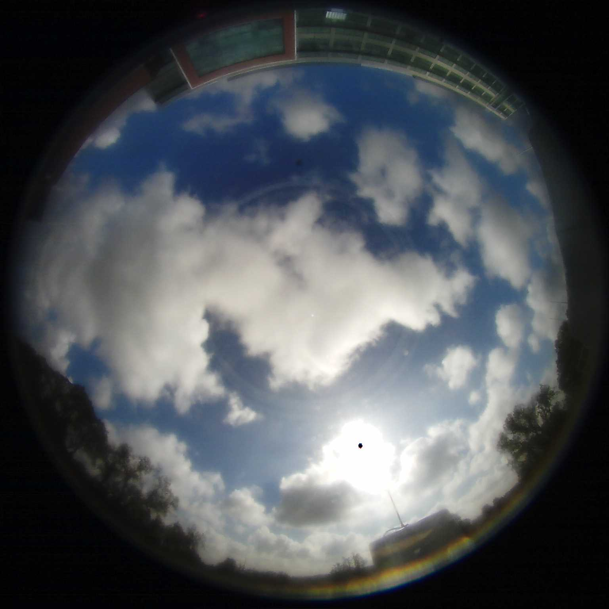
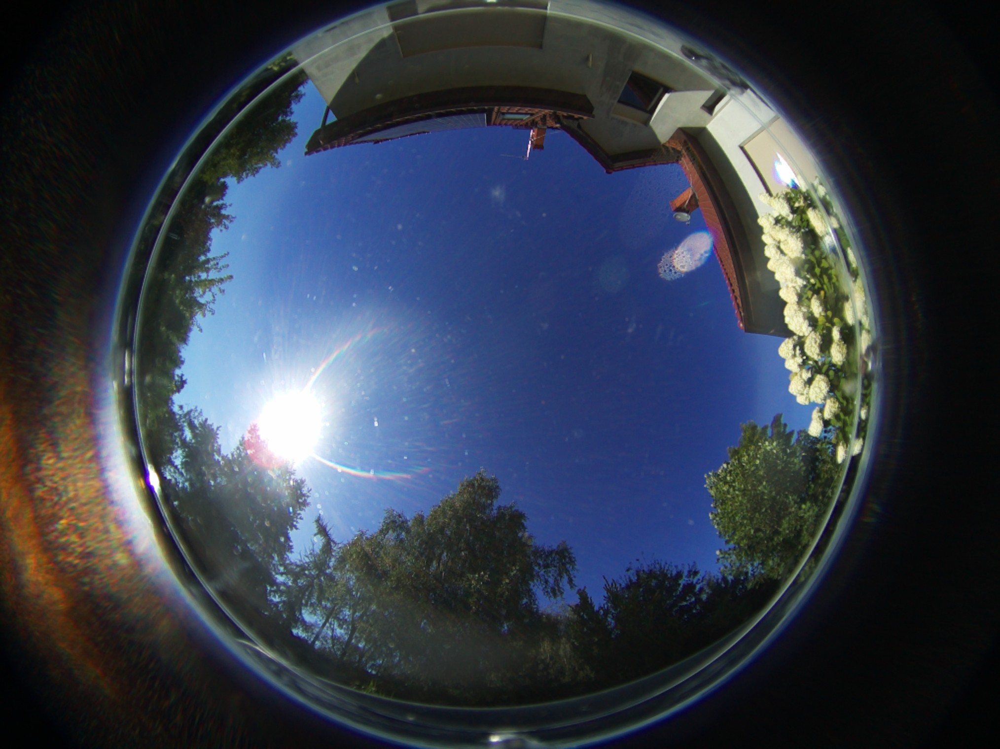
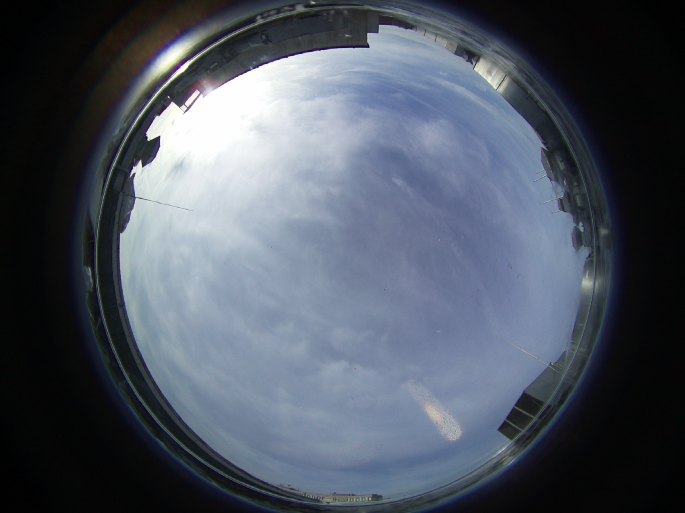
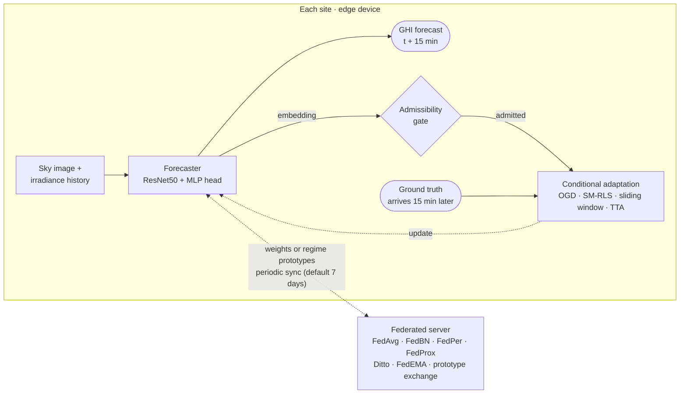

# Continual Solar Irradiance Forecasting

**Sky-image solar forecasting that keeps learning after deployment**: on edge devices, from labels that arrive late, and across sites that never share their data.

[](LICENSE)

<table align="center">
  <tr>
    <td align="center"></td>
    <td align="center"></td>
    <td align="center"></td>
  </tr>
  <tr>
    <td align="center"><b>Folsom, USA</b><br>source site<br></td>
    <td align="center"><b>Karpicko, Poland</b><br>target site</td>
    <td align="center"><b>Poznań, Poland</b><br>target site</td>
  </tr>
</table>

## What it does

The `cirr` package forecasts global horizontal irradiance (GHI) **15 minutes ahead** from an all-sky image and the last four irradiance readings. A model trained at one site (Folsom, 2014–2015) is deployed at new sites and has to keep adapting there, under three constraints:

- **Lagged labels.** The ground truth for a forecast made at *t* only arrives at *t* + 15 min, so every update is causal.
- **Unreliable frames.** Soiling, occlusions or banding on the camera dome must not drive adaptation.
- **Private data.** Sites collaborate by exchanging model weights or compact per-regime prototypes, never images.



| Capability | What it provides | Code · entry point |
|---|---|---|
| **Forecasting** | ResNet50 sky-image forecaster with irradiance history, BerHu loss, optional SupCon encoder pretraining and LoRA | `cirr/models`, `cirr/losses` · `scripts/dvc/train_forecaster.py` |
| **Delayed-feedback evaluation** | Online evaluation where each label is revealed only after the horizon; Smart Persistence baseline and forecast skill | `cirr/evaluation`, `cirr/continual` · `scripts/evaluate.py` |
| **Online adaptation** | Error-triggered OGD, sliding window, Sherman–Morrison RLS head, few-shot, dual-phase | `cirr/training` · `scripts/related_works/`, `scripts/evaluate_dual_phase.py` |
| **Test-time adaptation** | MEMO and NOTE, adapted for regression | `cirr/tta` · `scripts/evaluate.py --method memo\|note` |
| **Input admissibility** | Isolation Forest gate on the forecaster embedding; two-channel monitor (exclude frame / maintenance alert); synthetic camera faults | `cirr/evaluation/admissibility.py` · `scripts/fit_anomaly_gate.py`, `scripts/fit_monitor.py` |
| **Federated learning** | Weight aggregation baselines and regime-stratified prototype exchange (overcast / transient / clear) | `cirr/fl` · `scripts/fl_benchmark.py` |
| **Physics-informed input** | 7-channel input: RGB, sun mask × irradiance, normalised blue/red ratio, optical flow; sun-camera calibration | `cirr/physics`, `cirr/data` · `scripts/fit_sun_camera.py`, [docs/IEP_SETUP.md](docs/IEP_SETUP.md) |
| **Edge benchmarking** | Latency, memory, payload size and energy on Raspberry Pi / Jetson | `scripts/edge_hw_benchmark.py`, `scripts/edge_adaptation_benchmark.py`, `scripts/fl_edge_overhead_benchmark.py` |

## Installation

Python 3.10–3.12; a CUDA GPU is recommended for training.

```bash
git clone https://github.com/MatPiech/continual-solar-irradiance.git
cd continual-solar-irradiance
pip install -e ".[dev]"
```

## Data

Folsom (source site) is downloaded from [Zenodo 2826939](https://zenodo.org/records/2826939) and prepared by the DVC pipeline (~50 GB of raw images):

```bash
dvc repro get_data convert_timestamps clean_dataframe export_periods
cp data/folsom_prepared/train_periods.pickle data/folsom_prepared/periods.pickle
bash scripts/bash_scripts/generate_clear_sky_all.sh   # *_clear_sky.csv for every site
```

Every site lives in `data/<site>_prepared/` with the same layout; Folsom 2014–2015 is used for training and 2016 for testing.

| File | Role |
|---|---|
| `images/` | Sky images, named by UTC timestamp |
| `cleaned_irradiance.csv` | Irradiance aligned with image names |
| `train_periods.pickle`, `periods.pickle` | Training and test sample index (15-min horizon, 4 history samples at 5-min steps) |
| `<site>_clear_sky.csv` | Clear-sky GHI, used for the clear-sky index, gating and Smart Persistence |

## Quickstart

```bash
# 1. Train the forecaster on Folsom (hyperparameters in params.yaml)
python scripts/dvc/train_forecaster.py --data-root data/folsom_prepared

# 2. Static model and test-time adaptation at a target site
python scripts/evaluate.py --checkpoint checkpoints/epoch_XXX.ckpt --dataset-path data/poznan_prepared
python scripts/evaluate.py --checkpoint checkpoints/epoch_XXX.ckpt --dataset-path data/poznan_prepared --method memo

# 3. Conditional online adaptation under 15-min lagged labels
python scripts/related_works/evaluate_lagged_ogd.py --checkpoint checkpoints/epoch_XXX.ckpt --dataset-path data/poznan_prepared

# 4. Federated learning across the three sites
python scripts/fl_benchmark.py --checkpoint checkpoints/epoch_XXX.ckpt \
  --dataset data/folsom_prepared --dataset data/karpicko_prepared --dataset data/poznan_prepared \
  --algorithm fedproto --save-results results/fl/fedproto
```

Every script documents its options with `--help`.

## Repository layout

```
cirr/        installable package: data, models, physics, training, tta, continual, evaluation, fl
scripts/     experiment CLIs; dvc/ data pipeline, related_works/ adaptation comparators,
             skycam/ sky-camera data, bash_scripts/ batch wrappers
notebooks/   figures and data exploration
docs/        physics-informed input setup
```
